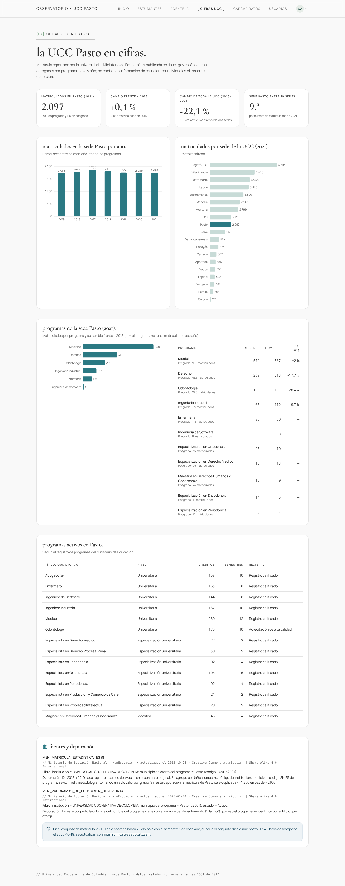
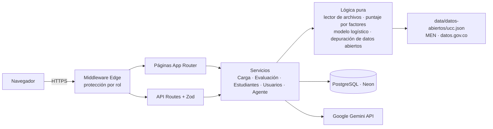
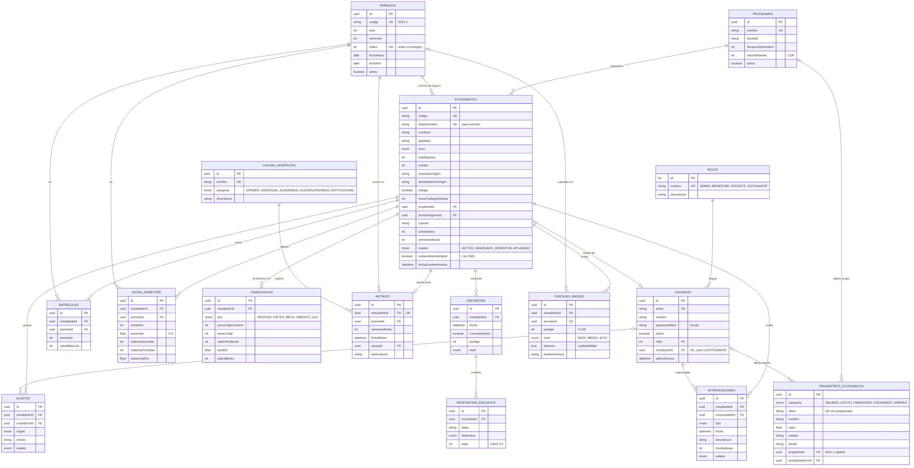

# Observatorio de Deserción UCC

Sistema web para **detectar a tiempo a los estudiantes que podrían retirarse** de la Universidad Cooperativa de Colombia (UCC), sede Pasto. Un **agente de IA (Google Gemini)** explica cada caso y responde preguntas del equipo de Bienestar Universitario.

Proyecto final de la asignatura *Programación Orientada a la Web*.

> **Versión 0.4.0: solo datos reales.** La versión anterior (0.3) tenía 1.500 estudiantes simulados y muchos módulos administrativos. Esta versión los elimina:
>
> - los **estudiantes** los carga el administrador desde un archivo real de la universidad; la base arranca vacía;
> - las **cifras institucionales** son las oficiales del Ministerio de Educación (datos.gov.co), filtradas solo para la UCC;
> - si un dato no existe, **no se muestra ni se inventa**.



---

## 1. Qué hace

| Página | Quién | Qué muestra |
|---|---|---|
| **Inicio** | Admin y Bienestar | Estudiantes activos por nivel de riesgo, riesgo por programa, factores más frecuentes y el método de cálculo vigente. |
| **Estudiantes en riesgo** | Admin y Bienestar | Lista ordenada del mayor al menor riesgo, con filtros por programa, nivel y búsqueda. |
| **Ficha del estudiante** | Admin y Bienestar | Factores que explican su riesgo (con la fuente de cada factor), sus datos y la **explicación del agente** con acciones sugeridas. |
| **Agente IA** | Admin y Bienestar | Chat con Gemini que consulta los datos del sistema («¿quiénes de Derecho tienen riesgo alto y por qué?»). |
| **Cifras oficiales UCC** | Admin y Bienestar | Matrícula oficial de la sede Pasto 2015-2021 por año, programa y sexo, comparación entre sedes y programas activos. |
| **Cargar datos** | Admin | Subir el archivo de estudiantes (Excel o CSV), plantilla, historial de cargas y borrado total. |
| **Usuarios** | Admin | Crear cuentas, cambiar rol, activar o desactivar, restablecer contraseña y desbloquear. |

Hay dos roles: **Administrador** (carga datos y gestiona cuentas) y **Bienestar Universitario** (consulta el riesgo y usa el agente).

**Diseño.** Estilo editorial y sobrio:

- fondo papel (`#F9F9F9`) con tinta grafito (`#303030`) y acentos apagados (petróleo, pino, salvia y marino) reservados para datos y estados;
- títulos en *Cormorant Garamond* (frases cortas en minúsculas que terminan en punto), texto en *Manrope* y detalles técnicos en monoespaciada;
- barra superior con la sección activa entre corchetes (`[ INICIO ]`) y cejas numeradas en cada página (`[01] INICIO`).

Las fuentes están autoalojadas con `@fontsource` (no se llama a Google Fonts) y la paleta está en `tailwind.config.ts`.

## 2. De dónde salen los datos

### 2.1 Cifras oficiales (datos.gov.co)

| Conjunto | Publica | Uso |
|---|---|---|
| [MEN_MATRICULA_ESTADISTICA_ES](https://www.datos.gov.co/d/5wck-szir) | Ministerio de Educación Nacional | Matrícula por programa, sexo, nivel y año |
| [MEN_PROGRAMAS_DE_EDUCACIÓN_SUPERIOR](https://www.datos.gov.co/d/upr9-nkiz) | Ministerio de Educación Nacional | Programas activos en Pasto (créditos, semestres, registro) |

Cómo se filtran:

- Se toma **solo** la institución `UNIVERSIDAD COOPERATIVA DE COLOMBIA`, comparando el nombre exacto y no por parecido. Así quedan fuera, por ejemplo, los conjuntos de «deserción académica» de datos.gov.co, que son de la UPTC (Boyacá).
- La sede Pasto se identifica por el código DANE del municipio de oferta (`52001`), no por el nombre escrito, que cambia entre años (`PASTO` / `Pasto`).

Problemas de los datos originales que se corrigen:

- **Registros duplicados.** De 2015 a 2019 cada registro aparece dos veces. Se deja uno por combinación (año, semestre, institución, municipio, código SNIES, sexo, nivel y metodología). Sin esta depuración, Pasto aparecería con unos 4.200 matriculados en vez de los 2.088–2.250 reales.
- **Nombres de programa inconsistentes.** Un mismo programa puede tener varios códigos SNIES (Ingeniería Industrial: 9107 y 107062) y escribirse de varias formas (`ODONTOLOGIA` / `Odontología`). Se agrupa por nombre sin tildes ni mayúsculas.
- **Columna dañada.** En el conjunto de programas, la columna del nombre trae el departamento («Nariño»), así que el programa se identifica por el título que otorga.
- **Cobertura incompleta.** La UCC aparece solo hasta 2021 y solo con el primer semestre de cada año, aunque el conjunto dice cubrir hasta 2024. La página lo advierte.

Los datos depurados se guardan en `data/datos-abiertos/ucc.json`, con la fuente, la fecha y la licencia (CC BY-SA 4.0). Para descargarlos de nuevo:

```bash
npm run datos:actualizar
```

Estos conjuntos **no traen datos de estudiantes individuales ni tasas de deserción**. Ninguna fuente pública los publica, porque lo impide la Ley 1581 de 2012.

### 2.2 Estudiantes (archivo de la universidad)

El administrador sube un `.xlsx` o `.csv` desde la página *Cargar datos*; en esa misma página se descarga la plantilla.

- **Columnas obligatorias:** `codigo`, `nombre`, `programa` y `semestre`.
- **Columnas opcionales:** `promedio`, `materias_perdidas`, `asistencia`, `estrato`, `trabaja`, `apoyo_financiero`, `mora_matricula`, `puntaje_saber11`, `edad`, `estado` (activo / retirado / graduado) y `periodo`.
- **Datos faltantes:** lo que no venga en el archivo no se usa en el cálculo del riesgo, y la ficha lo lista como «dato faltante».
- **Validación:** cada fila se valida (rangos, sí/no, duplicados). Las filas con error se rechazan y se informa el motivo con el número de fila.
- **Actualización:** si el código ya existe, el estudiante se actualiza. Después de cada carga se recalcula el riesgo.

## 3. Cómo se calcula el riesgo

### 3.1 Mientras no hay histórico: puntaje por factores

Es un puntaje de alerta de 0 a 100, **no una probabilidad**. Suma puntos por los factores de deserción que identifica el Ministerio de Educación (SPADIES, *Factores determinantes de la deserción*, 2016) y por los indicadores académicos del periodo:

| Factor | Puntos | Fuente |
|---|---|---|
| Promedio acumulado < 3,0 (12 si está entre 3,0 y 3,5) | 25 | Indicador académico |
| 2 o más materias perdidas (10 si es una) | 20 | Indicador académico |
| Asistencia < 70 % (8 si está entre 70 y 80 %) | 15 | Indicador académico |
| Pagos de matrícula pendientes | 15 | MEN-SPADIES |
| Primer o segundo semestre | 8 | MEN-SPADIES |
| Saber 11 < 250 | 7 | MEN-SPADIES |
| Trabaja mientras estudia | 5 | MEN-SPADIES |
| Estrato 1-2 sin beca, crédito ni subsidio | 5 | MEN-SPADIES |

Los niveles se asignan así: **medio** desde 20 puntos y **alto** desde 45. Los pesos son un **criterio experto explícito** (no se estimaron con datos) y están en `services/riesgo/factores.ts`.

### 3.2 Con histórico: modelo entrenado con estudiantes de la UCC

Si el archivo incluye estudiantes que ya se **retiraron** o se **graduaron**, el sistema entrena después de cada carga una **regresión logística** con esos casos reales. Usa Newton-Raphson con regularización L2, equivalente a scikit-learn, escrito en TypeScript.

El modelo se activa solo si se cumplen tres condiciones:

1. Hay al menos **200 estudiantes con resultado**, con al menos 30 retirados y 30 graduados.
2. Una variable entra al modelo solo si la tiene al menos el **80 % de los registros**.
3. Se evalúa con el **20 % de los estudiantes que no usó para aprender** (separación por código) y solo se activa con **AUC ≥ 0,70**.

Si no se cumplen, se sigue usando el puntaje por factores, y la página *Inicio* explica por qué. Con el modelo activo, el puntaje es la probabilidad estimada de retirarse. Los puntos de cada factor reparten el riesgo que el estudiante tiene por encima del estudiante promedio de la UCC.

## 4. El agente de IA (Gemini)

- **Explicación por estudiante:**
  - Gemini redacta en 130 palabras como máximo por qué el estudiante tiene ese nivel de riesgo y propone 2 o 3 acciones de Bienestar (tutorías, acuerdos de pago, acompañamiento de primer año…).
  - La explicación se guarda y se vuelve a generar si el riesgo cambia.
- **Chat con llamadas a funciones (function calling):** Gemini decide qué consultar y el servidor ejecuta la consulta contra la base de datos. Herramientas disponibles:
  - `resumen_riesgo`
  - `buscar_estudiantes`
  - `detalle_estudiante`
  - `cifras_oficiales_ucc`
- **Reglas del agente:**
  - responde solo con lo que devuelven las herramientas y nunca inventa estudiantes ni cifras;
  - trata el riesgo como una alerta para acompañar, no como un juicio.
- **Privacidad:**
  - a Gemini **nunca se envían nombres ni documentos**; los estudiantes viajan por código y con datos académicos;
  - el servidor agrega los nombres a la respuesta para quien tiene permiso de verlos.
- **Sin clave o con fallas:** sin `GEMINI_API_KEY`, todo funciona igual; el chat muestra un aviso y la ficha muestra una explicación calculada sin IA. Si Gemini falla o se alcanza el límite gratuito, también se muestra la explicación sin IA.
- **Modelo:** por defecto es `gemini-flash-latest` (variable `GEMINI_MODEL`). Si ese modelo no existe para la clave, el cliente consulta la lista de modelos y elige un Flash disponible.

## 5. Arquitectura



| Carpeta | Contenido |
|---|---|
| `app/(app)` | Páginas: inicio, estudiantes, agente, cifras-ucc, cargar, usuarios |
| `app/api` | `cargas`, `estudiantes`, `agente`, `usuarios`, `auth` |
| `services/carga` | Lector de CSV y Excel, validación y guardado por lotes (`INSERT … ON CONFLICT`) |
| `services/riesgo` | Variables, puntaje por factores, modelo logístico y servicio que recalcula |
| `services/agente` | Herramientas, ciclo de function calling y explicaciones |
| `lib/ia/gemini.ts` | Cliente REST de Gemini (sin dependencias) |
| `lib/datos-abiertos*.ts` | Filtro, depuración y resumen de los datos del MEN |
| `prisma` | Esquema, migraciones y cuenta inicial del administrador |

**Modelo de datos** (5 tablas):



## 6. Instalación local

Requisitos: Node 18.18 o superior y PostgreSQL (local o en Neon).

```bash
npm install                 # instala y genera el cliente de Prisma
cp .env.example .env        # edita DATABASE_URL, NEXTAUTH_SECRET, SEED_ADMIN_PASSWORD y GEMINI_API_KEY
npx prisma migrate deploy   # crea las tablas
npm run db:seed             # crea SOLO la cuenta del administrador (no hay datos de ejemplo)
npm run dev                 # http://localhost:3000
```

Entra con `admin@ucc.edu.co` (o el correo de `SEED_ADMIN_EMAIL`) y la contraseña de `SEED_ADMIN_PASSWORD`. Después carga el archivo de estudiantes desde *Cargar datos*.

## 7. Variables de entorno

| Variable | Obligatoria | Para qué |
|---|---|---|
| `DATABASE_URL` | Sí | Conexión con pooler (la crea la integración Neon–Vercel) |
| `DATABASE_URL_UNPOOLED` | Sí | Conexión directa para las migraciones |
| `NEXTAUTH_SECRET` | Sí | Firma de las sesiones (`openssl rand -base64 32`) |
| `SEED_ADMIN_PASSWORD` | Para crear el primer admin | Contraseña inicial del administrador; no hay contraseña por defecto. `SEED_DEMO_PASSWORD` se acepta por compatibilidad |
| `SEED_ADMIN_EMAIL` | No | Correo del primer administrador (por defecto `admin@ucc.edu.co`) |
| `GEMINI_API_KEY` | Para el agente | Clave gratuita de [Google AI Studio](https://aistudio.google.com/apikey) |
| `GEMINI_MODEL` | No | Modelo de Gemini (por defecto `gemini-flash-latest`) |

## 8. Despliegue (Vercel + Neon)

1. Importa el repositorio en Vercel y conecta Neon desde *Storage*. La integración crea `DATABASE_URL` y `DATABASE_URL_UNPOOLED`.
2. En *Settings → Environment Variables* agrega `NEXTAUTH_SECRET`, `SEED_ADMIN_PASSWORD` y `GEMINI_API_KEY`.
3. Despliega. El script `vercel-build` hace cuatro cosas, en orden:
   1. genera el cliente de Prisma;
   2. aplica las migraciones (`prisma migrate deploy`);
   3. crea el primer administrador si no existe ninguno;
   4. compila.

La migración `20261019000000_simplificacion_datos_reales` **borra las tablas de la versión 0.3**, que solo tenían datos simulados, y crea el esquema nuevo.

## 9. Seguridad y Ley 1581 de 2012

- Solo personal autorizado inicia sesión, con contraseñas bcrypt.
- Hay bloqueo de 15 minutos tras 5 intentos fallidos.
- La sesión es un JWT de 8 horas, revalidado contra la base de datos en cada petición: desactivar una cuenta corta el acceso de inmediato.
- Los permisos se verifican tres veces: en el middleware, en el layout y en cada endpoint.
- A la IA no se envían datos que identifiquen a la persona.
- El borrado total de estudiantes es exclusivo del administrador y pide confirmación escrita.

## 10. Pruebas

```bash
npm test          # Vitest
npm run typecheck
npm run lint
```

Las pruebas cubren:

- **Depuración de los datos del MEN:** los totales reales de Pasto, de 2.088 a 2.250 por año, y la suma de las sedes igual al total nacional.
- **Lector de archivos:** CSV, Excel, rangos, sí/no y duplicados.
- **Cálculo del riesgo:** el puntaje por factores, y que el modelo aprende y solo se activa con AUC ≥ 0,70.
- **Agente:** cliente de Gemini y ciclo de function calling, con respuestas simuladas.
- **Permisos y seguridad:** los dos roles, las reglas de cuentas y la sesión.

## 11. Historial de desarrollo (Git)

Cada funcionalidad se desarrolló en su propia rama y se integró a `main` con `--no-ff`. Los mensajes siguen *Conventional Commits* en español (`feat`, `fix`, `refactor`, `test`, `docs`, `chore`). Etiquetas:

- `v0.1.0-fase1`, `v0.2.0-fase2` y `v0.3.0-fase3`: versión con datos simulados.
- `v0.4.0`: esta versión, solo con datos reales y el agente de IA.

```bash
git log --oneline --graph --decorate
git log --merges --oneline v0.3.1..v0.4.0   # qué cambió en la simplificación
```
