# Observatorio de Deserción UCC

Sistema web que **mide el impacto de desertar** de la educación superior y ayuda a **detectar estudiantes en riesgo** en la Universidad Cooperativa de Colombia, sede Pasto.

Proyecto final de la asignatura *Programación Orientada a la Web*.

> **Estado actual: las tres fases están completas (versión 0.3.0).** Medición del impacto en cuatro dimensiones (económica, académica, institucional y social/regional), dashboard institucional, calculadora "¿qué pasa si me retiro?", modelo de riesgo con alerta temprana, encuesta de autoevaluación, panel docente, intervenciones con medición de su efectividad, reportes PDF/Excel, importación CSV y panel de administración completo (usuarios, catálogos, parámetros, reentrenamiento del modelo y auditoría).

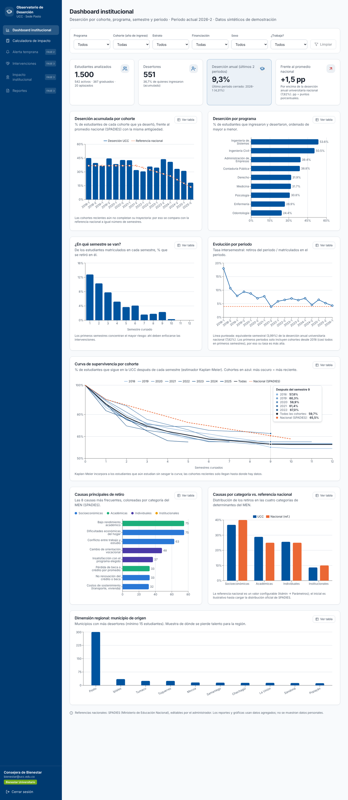

---

## 1. Problema

En Colombia, cerca de 4 de cada 10 estudiantes que ingresan a la educación superior la abandonan antes de terminar (SPADIES, MEN). La deserción tiene costos en cuatro dimensiones:

| Dimensión | Qué se pierde |
|---|---|
| **Económica (estudiante y familia)** | Dinero invertido, deuda sin título que la respalde, menores ingresos de por vida. |
| **Académica** | Créditos cursados sin titulación, trayectorias interrumpidas. |
| **Institucional (UCC)** | Ingresos por matrícula, indicadores de permanencia y graduación. |
| **Social y regional** | Talento que Nariño y el sur del país dejan de formar. |

Las decisiones de retiro suelen tomarse sin dimensionar estos costos y las alertas llegan tarde.

## 2. Objetivos

1. Medir el impacto de la deserción en las cuatro dimensiones.
2. Identificar estudiantes en riesgo y registrar intervenciones para evaluar si funcionan.
3. Permitir que un estudiante simule "¿qué pasa si me retiro?" antes de decidir.

## 3. Plan por fases

| Fase | Contenido | Estado |
|---|---|---|
| **1** | Proyecto, BD con Prisma y seed sintético, auth con roles, dashboard institucional, calculadora de impacto, despliegue en Vercel | ✅ Lista |
| **2** | Modelo de riesgo (regresión logística), alerta temprana, encuesta del estudiante, panel docente | ✅ Lista |
| **3** | Intervenciones y su efectividad, impacto institucional, reportes PDF/Excel, importación CSV, administración completa (usuarios, programas, periodos, reentrenamiento del modelo, auditoría), seguridad de cuentas y README final | ✅ Lista |

---

## 4. Arquitectura

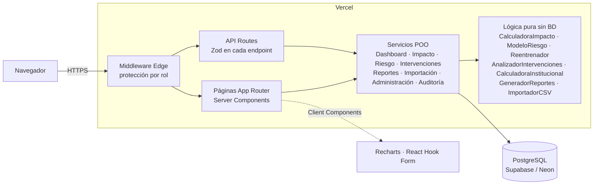

Un solo despliegue en **Vercel** (frontend + API) y la base de datos en **Supabase o Neon** (plan gratuito).

### Estructura de carpetas

```
observatorio-desercion-ucc/
├── app/                       # Rutas (App Router)
│   ├── (auth)/login/          # Inicio de sesión
│   ├── (app)/                 # Páginas protegidas (layout con menú por rol)
│   │   ├── dashboard/         # Dashboard institucional (+ loading.tsx)
│   │   ├── calculadora/       # Calculadora de impacto
│   │   ├── alerta-temprana/   # Lista priorizada y ficha del estudiante (Bienestar)
│   │   ├── encuesta/          # Autoevaluación del estudiante
│   │   ├── panel-docente/     # Señales académicas de los cursos del docente
│   │   ├── intervenciones/    # Registro, seguimiento y efectividad (Bienestar)
│   │   ├── impacto-institucional/ # Impacto institucional, académico y regional con proyección
│   │   ├── reportes/          # Descarga de reportes PDF y Excel anonimizados
│   │   ├── admin/             # Panel: parámetros, programas, periodos, usuarios, modelo, importar y auditoría
│   │   └── [modulo]/          # Página "próximamente" (solo para módulos de fases futuras)
│   ├── api/                   # API REST: auth, dashboard, impacto, riesgo, alertas, encuesta, docente,
│   │                          #   intervenciones, impacto-institucional, reportes y admin/*
│   └── acceso-denegado/
├── components/
│   ├── ui/                    # Componentes estilo shadcn/ui (button, card, input...)
│   ├── layout/                # Sidebar, formulario de login
│   ├── dashboard/             # Gráficas, filtros, KPIs
│   ├── calculadora/           # Formulario y resultados
│   ├── riesgo/                # Insignia de nivel, gráfica de factores, gestor de alertas
│   ├── encuesta/              # Formulario Likert y resultado
│   ├── docente/               # Panel docente
│   ├── intervenciones/        # Registro, cierre, gráfico de bosque y efectividad
│   ├── institucional/         # Proyección interactiva y gráficas de impacto
│   ├── reportes/              # Panel de reportes y botón de descarga
│   └── admin/                 # Parámetros, programas, periodos, usuarios, modelo, importación y auditoría
├── lib/                       # prisma, auth, rbac, roles, seguridad (bloqueo y sesión), validadores Zod
├── services/                  # Lógica de negocio (POO)
│   ├── impacto/               # CalculadoraImpacto (pura) + ServicioImpacto
│   ├── dashboard/             # calculos.ts (puro) + ServicioDashboard
│   ├── riesgo/                # ModeloRiesgo, EntrenadorLogistico, Reentrenador, ServicioRiesgo, ServicioModelo
│   ├── encuesta/              # Preguntas, EvaluadorEncuesta, ServicioEncuesta
│   ├── alertas/ · docente/    # ServicioAlertas, ServicioDocente
│   ├── intervenciones/        # AnalizadorIntervenciones (puro) + ServicioIntervenciones
│   ├── institucional/         # CalculadoraInstitucional (pura) + ServicioImpactoInstitucional
│   ├── reportes/              # Contenido, GeneradorReportes (PDF/Excel) y ServicioReportes
│   ├── importacion/           # Lector CSV, ImportadorCSV (puro) y ServicioImportacion
│   ├── admin/ · auditoria/    # ServicioCatalogos, ServicioUsuarios, reglas puras y ServicioAuditoria
│   └── parametros/            # ServicioParametros + conversores
├── prisma/
│   ├── schema.prisma          # 21 tablas
│   ├── migrations/            # Migraciones SQL: inicial, Fase 2 y Fase 3
│   ├── seed.ts                # Inserta los datos
│   └── seed/                  # Generador sintético (puro y determinista)
├── ml/                        # Exportación del panel, entrenamiento scikit-learn, notebook, reporte y modelo JSON
├── tests/                     # Vitest (189 pruebas en 18 archivos)
├── docs/                      # Diagrama ER y capturas
└── middleware.ts              # Protección de rutas por rol
```

### Clases principales (POO)

| Clase | Responsabilidad | Métodos clave |
|---|---|---|
| `CalculadoraImpacto` | Cálculo financiero puro (sin BD) | `calcular`, `calcularInversion`, `calcularDeuda`, `calcularCostoOportunidad`, `compararEscenarios`, `cuotaFrancesa` (estático) |
| `ServicioImpacto` | Carga perfiles y parámetros, aplica control de acceso individual | `perfilPorPrograma`, `perfilPorEstudiante`, `calcular` |
| `ServicioDashboard` | Consulta la BD con filtros combinables y arma el resumen | `construirWhere` (estático), `obtenerResumen` |
| `ServicioParametros` | Lectura y edición de parámetros OLE/SPADIES | `listar`, `actualizar`, `mapa`, `paraCalculadora`, `referenciasSpadies` |
| `ModeloRiesgo` | Aplica la regresión logística exportada desde Python: probabilidad, puntaje 0-100, nivel y aporte exacto de cada factor | `predecir`, `predecirVector`, `clasificar`, `principalesRiesgos` |
| `EntrenadorLogistico` | Ajusta la regresión logística en TypeScript (Newton-Raphson con L2), con los mismos coeficientes que scikit-learn | `ajustar`, `umbrales`, `definicion` |
| `Reentrenador` | Reentrena con los datos de la BD siguiendo el procedimiento del script de Python (prueba por estudiante, modelo final) y recomienda si activar | `entrenar`, `recomendar`, `nombreVersion` |
| `ServicioModelo` | Versiones del modelo: listar, reentrenar (auditado) y activar o volver a una anterior con recálculo de puntajes | `listar`, `entrenar`, `activar` |
| `ServicioRiesgo` | Recalcula puntajes, genera alertas del modelo, lista priorizada y ficha del estudiante | `recalcular`, `listaPriorizada`, `detalle` |
| `EvaluadorEncuesta` | Puntaje por dimensión y global de la encuesta, regla de intención de retiro y recursos sugeridos | `validar`, `evaluar` (estáticos) |
| `ServicioEncuesta` · `ServicioAlertas` · `ServicioDocente` | Encuesta con consentimiento, alertas con control de acceso por curso, señales académicas del docente | `responder`, `crear`, `cambiarEstado`… |
| `AnalizadorIntervenciones` | Efecto de las intervenciones ajustado por riesgo (ATT estratificado por franjas del modelo, IC 95 %) | `analizar` |
| `ServicioIntervenciones` | Registro, cierre auditado y efectividad sobre el modelo activo | `listar`, `crear`, `actualizar` (cierre), `efectividad` |
| `CalculadoraInstitucional` | Matrícula no percibida, graduación por cohorte, pérdida regional y proyección "si la deserción baja X %" | `calcular`, `proyectar` |
| `GeneradorReportes` | Convierte un mismo contenido anonimizado en PDF (jsPDF) o Excel (ExcelJS) | `aPdf`, `aExcel` |
| `ImportadorCSV` | Valida un CSV de Registro Académico celda por celda y entre filas antes de tocar la BD (todo o nada) | `analizar` |
| `ServicioUsuarios` · `ServicioCatalogos` | Cuentas, roles, activación, contraseñas y desbloqueo; CRUD de programas y periodos con reglas de integridad | `crear`, `actualizar`, `listar`; `crearPrograma`, `actualizarPeriodo`, `eliminarPrograma`… |
| `ServicioAuditoria` | Registro persistente de accesos a datos personales y cambios administrativos (Ley 1581) | `registrar`, `listar` |
| `Aleatorio` | Generador pseudoaleatorio con semilla para el seed | `normal`, `bernoulli`, `ponderado` |
| `ErrorApi` | Errores controlados con código HTTP | — |

> Patrón común: la lógica de negocio vive en clases **puras** (sin Prisma ni React) que se prueban con Vitest, y los `Servicio…` solo cargan datos, aplican permisos y auditan.

---

## 5. Modelo de datos (diagrama entidad-relación)

21 tablas: las 16 pedidas (`roles`, `usuarios`, `programas`, `periodos`, `estudiantes`, `matriculas`, `notas_semestre`, `financiacion`, `retiros`, `causas_desercion`, `encuestas`, `respuestas_encuesta`, `puntajes_riesgo`, `alertas`, `intervenciones`, `parametros_economicos`), 3 de la Fase 2 (`cursos` e `inscripciones` para el panel docente y `modelos_riesgo` para las versiones del modelo) y 2 de la Fase 3 (`importaciones` y `auditoria_accesos`). En la Fase 3 también se añadieron a `usuarios` los campos de bloqueo por intentos fallidos y a `intervenciones` el periodo, la alerta que la originó y el resultado. Versión completa con todos los atributos: [`docs/diagrama-er.png`](docs/diagrama-er.png) (fuente: [`docs/diagrama-er.mmd`](docs/diagrama-er.mmd)).

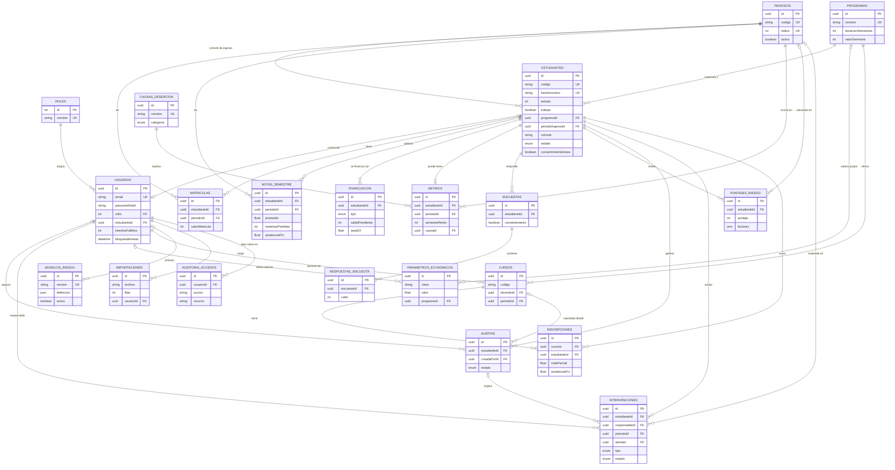

---

## 6. Instalación local

### Requisitos

- **Node.js 18.18 o superior** (recomendado 20 LTS): `node -v`
- Una base de datos PostgreSQL. Lo más simple es usar **el mismo proyecto gratuito de Supabase o Neon** que usarás en producción (sección 8). Alternativa con Docker:
  `docker run --name pg-ucc -e POSTGRES_PASSWORD=postgres -e POSTGRES_DB=observatorio -p 5432:5432 -d postgres:16`

> **Windows + OneDrive:** no instales el proyecto dentro de una carpeta sincronizada con OneDrive (por ejemplo `Escritorio` cuando está respaldado). `npm install` crea decenas de miles de archivos en `node_modules`; OneDrive intenta subirlos y suele provocar errores `EPERM`/`EBUSY` y lentitud. Copia la carpeta a una ruta local, por ejemplo `C:\dev\observatorio-desercion-ucc`, y trabaja desde ahí (en GitHub y Vercel no cambia nada).

### Pasos

```bash
# 1. Entrar a la carpeta e instalar dependencias (también genera el cliente de Prisma)
cd observatorio-desercion-ucc
npm install

# 2. Crear el archivo de variables de entorno
cp .env.example .env          # Windows PowerShell:  Copy-Item .env.example .env
#    ...y editar .env con tu DATABASE_URL, DIRECT_URL y NEXTAUTH_SECRET (sección 7)

# 3. Crear las tablas (aplica prisma/migrations)
npx prisma migrate deploy

# 4. Cargar los datos sintéticos (1.500 estudiantes, usuarios demo, parámetros)
npm run db:seed

# 5. Arrancar en modo desarrollo
npm run dev                   # abre http://localhost:3000
```

Comandos útiles:

| Comando | Para qué |
|---|---|
| `npm test` | Ejecuta las 60 pruebas de Vitest |
| `npm run typecheck` | Verifica tipos de TypeScript |
| `npm run lint` | ESLint |
| `npm run build` y `npm start` | Compila y ejecuta en modo producción |
| `npm run db:studio` | Abre Prisma Studio para ver las tablas |
| `npm run db:seed` | Vuelve a cargar los datos (borra y recrea) |
| `npm run ml:dataset` | Exporta el panel estudiante-semestre de la BD a `ml/datos/panel_entrenamiento.csv` |
| `npm run ml:entrenar` | Entrena el modelo con scikit-learn y escribe `ml/modelo_riesgo.json` y `ml/reporte_modelo.md` (requiere `pip install -r ml/requirements.txt`) |

### Usuarios demo

| Rol | Correo | Ve |
|---|---|---|
| ADMIN | `admin@ucc.edu.co` | Todo, más el panel de administración (parámetros, programas, periodos, usuarios, modelo, importación y auditoría) |
| BIENESTAR | `bienestar@ucc.edu.co` (también `bienestar2` y `bienestar3`) | Dashboard, alerta temprana (lista y ficha), intervenciones, impacto institucional, reportes y calculadora con perfil por código |
| DOCENTE | `docente@ucc.edu.co` (también `docente2` a `docente9`) | Panel docente con sus cursos del periodo 2026-2 y la calculadora |
| ESTUDIANTE | `estudiante@ucc.edu.co` | Su calculadora con sus datos precargados y la encuesta de autoevaluación |

La contraseña de todas es la de la variable `SEED_DEMO_PASSWORD` del `.env` (valor de ejemplo en `.env.example`). **Cámbiala antes de compartir la URL pública** y vuelve a correr el seed. Tras 5 contraseñas incorrectas seguidas la cuenta se bloquea 15 minutos (el administrador puede desbloquearla en Admin → Usuarios).

---

## 7. Variables de entorno

| Variable | Descripción | Ejemplo |
|---|---|---|
| `DATABASE_URL` | Conexión que usa la app (en Vercel: **con pooler**) | `postgresql://...:6543/postgres?pgbouncer=true&connection_limit=1` |
| `DIRECT_URL` | Conexión directa para migraciones de Prisma | `postgresql://...:5432/postgres` |
| `NEXTAUTH_SECRET` | Secreto para firmar la sesión (mínimo 32 caracteres aleatorios) | ver abajo |
| `NEXTAUTH_URL` | URL pública de la app | `http://localhost:3000` / `https://tu-app.vercel.app` |
| `SEED_DEMO_PASSWORD` | Contraseña de las cuentas demo (solo la usa el seed) | |

Generar `NEXTAUTH_SECRET`:

```bash
openssl rand -base64 32
# Windows (sin openssl):
node -e "console.log(require('crypto').randomBytes(32).toString('base64'))"
```

---

## 8. Despliegue paso a paso (Supabase o Neon + Vercel)

### 8.1 Base de datos

**Opción A — Supabase**

1. Entra a <https://supabase.com>, crea un proyecto (región recomendada: **South America (São Paulo)**) y guarda la contraseña de la base de datos.
2. Botón **Connect** → pestaña **ORMs** → **Prisma**. Copia las dos cadenas:
   - `DATABASE_URL` → la del **Transaction pooler** (puerto **6543**) y agrega al final `&connection_limit=1` (si no tiene `?`, usa `?pgbouncer=true&connection_limit=1`).
   - `DIRECT_URL` → la del **Session pooler / conexión directa** (puerto **5432**).
3. Reemplaza `[YOUR-PASSWORD]` por tu contraseña.

**Opción B — Neon**

1. Entra a <https://neon.tech>, crea un proyecto (región cercana, p. ej. AWS São Paulo o US East).
2. En **Connection Details**: con **Connection pooling** activado copia la cadena para `DATABASE_URL` (host con `-pooler`) y agrega `&pgbouncer=true&connection_limit=1`; desactívalo y copia la otra para `DIRECT_URL`. Ambas deben terminar con `sslmode=require`.

### 8.2 Crear las tablas y cargar los datos (desde tu PC, una sola vez)

Pon esas dos cadenas en tu `.env` local y ejecuta:

```bash
npx prisma migrate deploy
npm run db:seed
```

Debe mostrar `✅ Seed completado` con 1.500 estudiantes.

### 8.3 Subir el código a GitHub

El proyecto **ya es un repositorio Git** con todo el historial de desarrollo (ver sección 16). Crea un repositorio **vacío** en github.com (sin README ni .gitignore) y sube todas las ramas y etiquetas:

```bash
cd observatorio-desercion-ucc
git remote add origin https://github.com/TU_USUARIO/observatorio-desercion-ucc.git
git push -u origin main
git push origin --all      # ramas de cada funcionalidad (trazabilidad)
git push origin --tags     # v0.1.0-fase1, v0.2.0-fase2, v0.3.0-fase3
```

El `.gitignore` ya excluye `.env` y `node_modules`: **nunca subas tu `.env`**.

### 8.4 Vercel

1. Entra a <https://vercel.com> con tu cuenta de GitHub → **Add New… → Project** → importa el repositorio.
2. Framework: **Next.js** (se detecta solo). Deja el *Build Command* por defecto (`npm run build`, que ejecuta `prisma generate && next build`).
3. En **Environment Variables** agrega: `DATABASE_URL`, `DIRECT_URL`, `NEXTAUTH_SECRET` y `NEXTAUTH_URL` (pon temporalmente `https://observatorio-desercion-ucc.vercel.app` o el nombre que elijas).
4. **Deploy**. Cuando termine, copia la URL real (Settings → Domains), actualiza `NEXTAUTH_URL` con ella y haz **Redeploy**.
5. Prueba: abre la URL, entra con `bienestar@ucc.edu.co` y revisa el dashboard; luego con `estudiante@ucc.edu.co` y calcula el impacto.

> Consejo: en Vercel → Settings → Functions, elige la región de las funciones **igual o cercana** a la de la base de datos (p. ej. `gru1` São Paulo si usas Supabase São Paulo) para que las consultas sean rápidas.

### 8.5 Solución de problemas

| Síntoma | Causa probable y solución |
|---|---|
| `Environment variable not found: DIRECT_URL` | Falta `DIRECT_URL` en `.env` o en Vercel. |
| `prepared statement "s0" already exists` | `DATABASE_URL` usa el pooler sin `?pgbouncer=true`. |
| Login vuelve a /login sin error en Vercel | `NEXTAUTH_URL` no coincide con la URL real o falta `NEXTAUTH_SECRET`. Corrige y haz Redeploy. |
| `Can't reach database server` | Cadena de conexión o contraseña incorrecta; en Neon falta `sslmode=require`. |
| `prisma migrate deploy` falla con el pooler | Las migraciones usan `DIRECT_URL` (puerto 5432): revísala. Alternativa: `npx prisma db push`. |
| El dashboard aparece vacío | No se ejecutó `npm run db:seed` contra esa base de datos. |

---

## 9. Cómo funciona

### 9.1 Datos sintéticos (seed)

Los datos reales son privados (Ley 1581 de 2012), así que `prisma/seed/generador.ts` simula **1.500 estudiantes** de 9 programas, cohortes **2018-1 a 2025-2**, con edad, sexo, estrato, municipio de origen (Nariño, Putumayo, Cauca, Valle), trabajo y horas, financiación (recursos propios, ICETEX, beca, crédito UCC), notas, materias perdidas y asistencia por semestre.

La deserción **no se asigna al azar**: se simula semestre a semestre con un modelo logit que depende de estrato, carga laboral, promedio, materias perdidas, asistencia, financiación, programa y semestre (el riesgo es mayor en los primeros semestres). Está calibrado para que la deserción acumulada a 10 semestres ronde el **40 %** (SPADIES nacional: 36,7 %); con las intervenciones de Bienestar de la Fase 3, la curva Kaplan-Meier del dataset da 38,2 % en total y entre 38,6 % y 42,8 % en las cohortes 2018-2021. Cada retiro tiene una causa clasificada en las **cuatro categorías del MEN (SPADIES)**: individuales, académicas, socioeconómicas e institucionales, elegida según el perfil del estudiante. El generador es **determinista** (semilla fija): siempre produce el mismo dataset.

### 9.2 Dashboard institucional

Tasa de deserción por **cohorte, programa, semestre cursado y periodo**, curva de supervivencia por cohorte, causas principales, dimensión regional por municipio y comparación con el promedio nacional. Seis **filtros combinables** (programa, cohorte, estrato, financiación, sexo, trabajo) guardados en la URL. Cada gráfica tiene una vista alternativa en **tabla**.

Decisiones metodológicas:
- **Censura de cohortes recientes.** Una cohorte de 2025 aún no termina, así que su "desertores/total" parece baja. Por eso cada cohorte se compara con la referencia nacional **a la misma antigüedad**, y la curva de supervivencia usa el estimador **Kaplan-Meier** (cuenta a los estudiantes activos solo hasta su último semestre completo y trata a los graduados como salidas sin evento).
- **Tasa por periodo:** retiros del periodo / matriculados del periodo. La referencia anual nacional se convierte a su equivalente semestral, `1 − √(1 − anual)`, para comparar en la misma escala.
- **Tasa anual institucional:** combina los dos últimos periodos cerrados, `1 − (1 − t₁)(1 − t₂)`.

### 9.3 Calculadora de impacto ("¿qué pasa si me retiro?")

| Resultado | Cálculo |
|---|---|
| **Dinero invertido** | matrícula (real o valor × semestres) + transporte × meses + materiales × semestres + sostenimiento × meses; y quién lo pagó (deuda, beca, familia). |
| **Deuda** | Cuota fija (sistema francés): `C = S·i / (1 − (1+i)^−n)`, con `i = (1+EA)^(1/12) − 1`. Se muestra qué % del ingreso se va en la cuota **sin título** vs **con título**. |
| **Costo de oportunidad** | Simulación mes a mes de ingresos de profesional vs bachiller/técnico/tecnólogo a **10, 20 y 30 años**, con crecimiento salarial real y **valor presente neto** `VP = Σ flujoₘ / (1+r)^(m/12)`. Se reporta la diferencia de ingresos y la diferencia **neta** (restando lo que cuesta terminar). |
| **Punto de equilibrio** | Año en que el camino "graduarme" recupera lo invertido frente a "retirarme". |
| **Escenarios** | Retirarse (línea base), continuar, aplazar un semestre, jornada nocturna/virtual (más duración, trabajo simultáneo, descuento) y apoyo financiero (beca parcial). |

Simplificaciones explícitas: valores en pesos reales (sin inflación); el sostenimiento no entra en la comparación de escenarios (se paga igual estudiando o trabajando); la deuda existente se paga en todos los escenarios.

Todos los supuestos (SMMLV 2026, salarios de enganche del Observatorio Laboral para la Educación por programa, tasas, crecimiento, tasa de descuento, referencias SPADIES) se editan en **Admin → Parámetros** sin tocar código. Los salarios por programa incluidos son **valores de ejemplo**: actualízalos con <https://ole.mineducacion.gov.co> antes de la sustentación final.

### 9.4 Modelo de riesgo (regresión logística)

**Pregunta que responde:** ¿qué probabilidad tiene este estudiante de desertar al terminar el semestre que cursa o el siguiente (un año académico)?

1. **Panel estudiante-semestre** (`services/riesgo/caracteristicas.ts`): una fila por cada semestre cursado, con 21 características que la universidad conoce durante el semestre: promedio, materias perdidas, asistencia, caída del promedio, horas de trabajo, estrato, edad de ingreso, semestre, financiación y programa. **No se usan sexo ni municipio** (evitan sesgos y no son accionables). Los semestres cuyo desenlace aún no se conoce (censurados) se excluyen del entrenamiento.
2. **Exportación** (`npm run ml:dataset`) → CSV, y **entrenamiento** en Python (`ml/entrenar_modelo.py`): `StandardScaler` + `LogisticRegression(C=1)` de scikit-learn, separación entrenamiento/prueba **por estudiante** (sin fuga de información), validación cruzada de 5 pliegues y comparación contra una regla simple. Se exportan coeficientes, medias y desviaciones a `ml/modelo_riesgo.json`. El análisis completo está en el notebook `ml/modelo_riesgo.ipynb` y en [`ml/reporte_modelo.md`](ml/reporte_modelo.md).
3. **Predicción en TypeScript** (`ModeloRiesgo`): sin servidor Python en producción. `p = 1/(1+e^-(b₀ + Σ βᵢ·zᵢ))`, puntaje = `round(100·p)`.
4. **Explicación exacta**: como las variables están estandarizadas, el aporte de cada factor es `βᵢ·zᵢ` (cuánto aleja al estudiante del promedio). La suma de aportes más el intercepto reconstruye la probabilidad; no es una aproximación.
5. **Reentrenamiento sin Python**: `EntrenadorLogistico` resuelve el mismo problema con Newton-Raphson y una prueba automática verifica que reproduce los coeficientes de scikit-learn. El administrador lo usa desde **Admin → Modelo de riesgo** (sección 9.12).

| Métrica (conjunto de prueba) | Valor |
|---|---|
| AUC-ROC | **0,851** (validación cruzada 0,815 ± 0,011) |
| AUC de la regla "promedio bajo" | 0,770 |
| Brier | 0,079 |
| Precisión / sensibilidad del nivel ALTO | 51,7 % / 41,6 % |
| Niveles | BAJO < 11 % · MEDIO 11-27 % · ALTO ≥ 27 % (tasa base 10,7 %) |

Versión `sklearn-20261009`, reentrenada en la Fase 3 con los datos que ya incluyen las intervenciones de Bienestar. Detalle en [`ml/reporte_modelo.md`](ml/reporte_modelo.md).

### 9.5 Alerta temprana (Bienestar)

Lista priorizada de los estudiantes activos ordenada por puntaje, con nivel (ícono + texto, no solo color), los 3 factores que más pesan, alertas abiertas y filtros por nivel, programa, semestre y búsqueda. Botón para **recalcular** todos los puntajes con el modelo activo (genera alertas automáticas para los de nivel ALTO). La **ficha del estudiante** muestra la gráfica de factores, el historial de notas, los cursos del periodo, la última encuesta y las alertas, cuyo estado (abierta, en seguimiento, cerrada) gestiona Bienestar. Cada consulta individual queda en el registro de auditoría.

### 9.6 Encuesta de autoevaluación (estudiante)

16 preguntas Likert en cuatro dimensiones (económica, académica, motivación y entorno), algunas invertidas para evitar respuestas automáticas. Exige **consentimiento informado** antes de empezar y pregunta si autoriza que Bienestar lo contacte. `EvaluadorEncuesta` calcula el puntaje por dimensión y global (BAJO < 35, MEDIO 35-55, ALTO ≥ 55); si el estudiante declara intención de retirarse, el nivel sube al menos a MEDIO. Al terminar ve su resultado y los **recursos** de la UCC según sus dimensiones más altas (tutorías, becas, apoyo psicológico, bienestar). Solo si el resultado es ALTO **y** autorizó el contacto se crea una alerta para Bienestar.

### 9.7 Panel docente

El docente ve únicamente sus cursos del periodo actual con la nota parcial, asistencia y fallas de cada estudiante, y las **señales** (nota parcial < 3,0 o asistencia < 80 %). Puede reportar una alerta a Bienestar desde cada fila. Por **minimización de datos** no ve el puntaje del modelo ni información socioeconómica, y la API verifica que el estudiante esté inscrito en uno de sus cursos antes de aceptar el reporte.

### 9.8 Intervenciones y su efectividad (Bienestar)

Bienestar registra cada acción (tutoría académica, apoyo económico con monto obligatorio, acompañamiento psicológico, orientación vocacional u otra) desde la lista o desde la ficha del estudiante, y puede vincularla a una alerta abierta. Al cerrarla anota el resultado. La lista se filtra por estado, tipo y estudiante, y muestra la **situación actual** de cada intervenido (sigue estudiando, se graduó o desertó).

**¿Funcionan?** Comparar intervenidos con no intervenidos "a secas" es injusto: Bienestar atiende justamente a quienes tienen más riesgo (sesgo de selección), y por eso la comparación ingenua sale negativa. `AnalizadorIntervenciones` estratifica las filas estudiante-semestre por la **probabilidad de deserción que estima el modelo**, compara dentro de cada franja y promedia las diferencias ponderando por los intervenidos: es el **efecto promedio en los tratados (ATT)**, con **intervalo de confianza del 95 %**. Se muestra junto a la comparación ingenua, por tipo de intervención en un gráfico de bosque, la permanencia por franja de riesgo y la cobertura del acompañamiento por periodo. La página advierte que es un análisis observacional: muestra asociación, no causalidad.

### 9.9 Impacto institucional, académico y regional

`CalculadoraInstitucional` cuantifica, con el filtro por programa:

- **Institucional (UCC):** matrícula no percibida por los semestres que los desertores ya no cursaron, matrícula futura perdida por año de retiro y graduación por cohorte.
- **Académica:** semestres cursados que no terminaron en un título.
- **Social y regional:** ingresos de por vida (valor presente a 20 años) que cada municipio y departamento de origen deja de generar. Se calcula por estudiante con la misma `CalculadoraImpacto` de la calculadora individual.
- **Proyección:** con un control deslizante, "¿y si la deserción bajara X %?". Muestra cuántos estudiantes seguirían estudiando, la matrícula recuperada, la nueva tasa anual, la graduación de las cohortes y el ingreso que ganaría la región. Se calcula en el navegador.

### 9.10 Reportes PDF y Excel

Cuatro reportes: **institucional** (lo mismo del dashboard), **lista de riesgo** (código anónimo, programa, semestre, puntaje, nivel y factores, sin nombres ni documentos), **efectividad de las intervenciones** e **impacto institucional y regional**. Cada uno se descarga en PDF (encabezado institucional, indicadores, barras y tablas paginadas) o en Excel (hoja de resumen y una hoja por tabla, con formato colombiano), con filtro opcional por programa. `GeneradorReportes` produce ambos formatos a partir del **mismo contenido**, que ya viene anonimizado. Cada exportación queda en la auditoría y el usuario ve su propio historial.

### 9.11 Importación de datos reales (CSV)

Admin → Importar recibe el reporte de Registro Académico: una fila por estudiante y semestre cursado, con **25 columnas** (21 obligatorias). Se puede descargar una plantilla de ejemplo. El lector detecta el separador (coma o punto y coma), las comillas, el BOM y los finales de línea de Windows, y acepta alias de encabezados y la coma decimal. `ImportadorCSV` valida cada celda, las reglas entre columnas (por ejemplo, la causa de retiro es obligatoria si el estado es DESERTOR) y que los datos de un mismo estudiante coincidan en todas sus filas. Primero se muestra una **vista previa** con los errores por fila y columna. Solo si no hay ninguno se puede confirmar, y la importación es **transaccional, todo o nada**: no quedan trayectorias a medias. Límites: 5 MB y 10.000 filas. Cada carga queda registrada en el historial de importaciones y en la auditoría.

### 9.12 Administración

- **Panel** con el periodo actual y los conteos principales, más acceso a cada sección.
- **Parámetros:** salarios OLE, costos, tasas, escenarios y referencias SPADIES (Fase 1).
- **Programas:** crear, editar (duración, matrícula y salario de enganche propio), activar o desactivar, y eliminar solo si no tiene estudiantes.
- **Periodos:** el sistema propone el siguiente periodo y valida las fechas. Activar el periodo actual pide confirmación.
- **Usuarios y roles:** crear cuentas, cambiar el rol, desactivar, restablecer la contraseña (mínimo 8 caracteres con letras y números) y desbloquear. Nadie puede desactivarse ni quitarse el rol ADMIN a sí mismo, y el sistema nunca se queda sin un administrador activo. Desactivar una cuenta o cambiarle el rol **corta su acceso de inmediato**, sin esperar a que venza la sesión de 8 horas.
- **Modelo de riesgo (reentrenamiento):** con un clic, `Reentrenador` vuelve a entrenar la regresión logística con los datos actuales de la BD y el mismo procedimiento del script de Python. Separa el 20 % de los **estudiantes** para medir el AUC fuera de muestra y luego ajusta el modelo final con todos los datos. Compara la versión nueva con la activa sobre las **mismas filas de prueba**: las dos se entrenaron con todos los datos disponibles en su momento, así que la comparación es simétrica. Con eso recomienda activar, revisar o no activar, según una regla documentada:
  - **No activar:** el entrenamiento no convergió o el AUC cae más de 0,02.
  - **Revisar:** el AUC cae entre 0,005 y 0,02, el Brier empeora más de 5 % o hay pocos desertores en la prueba.
  - **Activar:** en cualquier otro caso.

  También muestra las variables con más peso para revisar que los signos tengan sentido. La versión nueva queda **inactiva** hasta que el administrador la active. Al activarla se recalculan los puntajes de la alerta temprana, y desde el historial se puede **volver a cualquier versión anterior**. Con los datos del seed, reentrenar tarda menos de un segundo y reproduce el modelo de scikit-learn.
- **Auditoría de accesos:** consultas a datos individuales, exportaciones, importaciones, intervenciones, bloqueos y cambios administrativos, filtrable por acción. Los estudiantes aparecen siempre con su código anónimo.

---

## 10. Seguridad y Ley 1581 de 2012 (habeas data)

- **Autenticación** con Auth.js (credenciales), contraseñas con **bcrypt**, sesión JWT firmada de 8 horas.
- **Fuerza bruta:** tras 5 contraseñas incorrectas seguidas la cuenta se bloquea 15 minutos; el login lo informa y el bloqueo queda en la auditoría.
- **Revocación inmediata:** en cada petición se revalida la sesión contra el estado actual de la cuenta (activa, existente, rol vigente). Desactivar o cambiar el rol corta el acceso al instante.
- **Autorización por rol en dos capas**: `middleware.ts` (antes de renderizar) y cada endpoint (`manejar(roles, …)`). Fuente única de permisos: `lib/rbac.ts`.
- **Datos individuales** solo para ADMIN y BIENESTAR (y cada estudiante los suyos). Un docente o estudiante que pida el código de otro estudiante recibe solo valores generales. Cada consulta individual, exportación, importación y cambio administrativo queda en la tabla persistente `auditoria_accesos` (principio de responsabilidad demostrada), visible en Admin → Auditoría y siempre con el código anónimo del estudiante.
- **Anonimización**: cada estudiante tiene un `hashAnonimo`; el dashboard y el impacto institucional solo muestran agregados y los reportes exportables nunca incluyen nombres ni documentos.
- **Consentimiento**: campos `consentimientoDatos` / `fechaConsentimiento` en estudiantes; la encuesta no se puede responder sin consentimiento y la alerta a Bienestar requiere autorización expresa de contacto.
- **Minimización**: el docente solo ve datos académicos de sus cursos; el puntaje del modelo y los datos socioeconómicos son solo para Bienestar y Administración.
- **Validación Zod** en cada endpoint con mensajes en español; errores controlados con códigos HTTP correctos (400, 401, 403, 404).
- El login solo redirige a rutas internas (rechaza `//sitio` y `/\sitio`, evitando redirecciones abiertas).

---

## 11. Decisiones técnicas (resumen para sustentar)

| Decisión | Por qué |
|---|---|
| **Next.js App Router** | Front y API en un solo proyecto y un solo despliegue gratuito en Vercel; Server Components consultan la BD sin exponer credenciales. |
| **Prisma + PostgreSQL** | Esquema tipado de extremo a extremo y migraciones versionadas; Postgres gratis en Supabase/Neon. |
| **Auth.js con JWT** | El rol viaja firmado en la cookie: el middleware puede autorizar en el Edge sin consultar la BD. |
| **Lógica pura separada de la BD** | `CalculadoraImpacto` y `calculos.ts` no conocen Prisma ni React: se prueban con Vitest en milisegundos y se reutilizan. |
| **Agregación en memoria** | ~1.500 registros: más simple y flexible para filtros combinables que una consulta SQL por gráfica. Con cientos de miles se pasaría a vistas SQL. |
| **Filtros en la URL** | Se pueden compartir y el servidor recalcula con los mismos parámetros. |
| **IDs UUID y montos `Int`** | UUID evita enumerar registros y permite crear relaciones antes de insertar; el peso colombiano no usa decimales. |
| **Roles en tabla** | Normalizado: agregar un rol no requiere migrar un enum. |
| **Parámetros en BD** | Salarios OLE y valores SPADIES cambian cada año: el admin los actualiza sin desplegar. |
| **Select nativo** | Accesible y ligero para filtros; los demás componentes siguen el estilo de shadcn/ui. |
| **Kaplan-Meier** | Evita el sesgo de las cohortes que aún no terminan. |
| **Generador con semilla** | Datos reproducibles: los tests y la sustentación muestran siempre los mismos números. |
| **Efecto ajustado por riesgo (ATT estratificado)** | Bienestar interviene a los de mayor riesgo; comparar sin ajustar mostraría que intervenir "empeora", lo cual es un sesgo de selección. |
| **Reentrenamiento en TypeScript** | Mismo resultado que scikit-learn sin mantener un servidor Python en producción; el script y el notebook de Python siguen siendo la referencia del análisis. |
| **Versiones del modelo en la BD** | Activar o volver atrás es un cambio de datos, no un despliegue; cada versión guarda sus métricas y quién la entrenó. |
| **Un contenido, dos formatos** | El reporte se arma una vez (anonimizado) y `GeneradorReportes` lo convierte a PDF o Excel: no hay riesgo de que los formatos digan cosas distintas. |
| **Importación todo o nada** | Una importación parcial dejaría trayectorias incompletas que sesgan el modelo y los indicadores. |
| **Auditoría que no tumba la operación** | Si registrar el evento falla, la operación principal sigue y el error se informa en el log. |

---

## 12. Pruebas y verificación

```bash
npm test
```

**189 pruebas** en 18 archivos:

| Archivo | Pruebas | Qué verifica |
|---|---|---|
| `calculadora-impacto.test.ts` | 30 | Inversión, cuota francesa contra un valor verificado, deuda con y sin título, VPN vs. nominal, horizontes, punto de equilibrio, escenarios y entradas inválidas |
| `importacion-importador.test.ts` | 16 | Archivo válido, alias, errores por fila y columna, consistencia por estudiante, todo o nada y plantilla |
| `riesgo-reentrenamiento.test.ts` | 16 | El reentrenamiento reproduce scikit-learn, evalúa por estudiante, regla de recomendación, efecto de la regularización y nombre de versión |
| `riesgo-modelo.test.ts` | 15 | Entrenador TS = scikit-learn, explicación exacta de la probabilidad, niveles, AUC y métricas |
| `seed-integridad.test.ts` | 14 | Llaves foráneas, unicidad, coherencia estado/retiro/intervenciones y realismo de la deserción simulada |
| `dashboard-calculos.test.ts` | 12 | Kaplan-Meier calculado a mano y censura, tasas por cohorte, semestre y periodo, causas y KPIs |
| `reportes-generador.test.ts` | 11 | Formato colombiano, texto seguro en PDF, hojas de Excel y paginación |
| `riesgo-caracteristicas.test.ts` | 11 | Etiquetas del panel a dos semestres, exclusión de semestres censurados y vectorización |
| `impacto-institucional.test.ts` | 9 | Montos, línea base anual, cohortes con plazo vencido y proyección calculada a mano |
| `encuesta.test.ts` | 8 | Puntajes extremos, preguntas invertidas, regla de intención de retiro y validación |
| `importacion-csv.test.ts` | 8 | Lector de CSV: separador, comillas, BOM, finales de Windows y encabezados |
| `intervenciones-analizador.test.ts` | 7 | Sesgo de selección, intervalo de confianza, franjas mínimas, efecto por tipo y cobertura |
| `reportes-contenido.test.ts` | 7 | La lista de riesgo no tiene campos personales, efectos con signo y proyección creciente |
| `admin-reglas.test.ts` | 6 | Índice de periodos, fechas, política de contraseñas y protección del último administrador |
| `conversores.test.ts` | 6 | Conversión de parámetros y referencias SPADIES |
| `seed-academico.test.ts` | 5 | Cursos, docentes e inscripciones coherentes con el periodo en curso |
| `seguridad-bloqueo.test.ts` | 4 | Bloqueo tras 5 intentos, expiración a los 15 minutos y reinicio |
| `seguridad-sesion.test.ts` | 4 | Revalidación de la sesión: cuenta activa, cambio de rol, cuenta desactivada o eliminada |

Además, cada fase se verificó de punta a punta contra **PostgreSQL 16**: la migración `prisma/migrations` (estructura idéntica al esquema: columnas, tipos, restricciones, índices y enums), seed y re-seed, login de los 4 roles, matriz de permisos de todas las rutas y APIs (69 verificaciones), validaciones con mensajes en español, edición de parámetros reflejada en calculadora y dashboard, y el flujo completo en navegador (Chromium) en escritorio y móvil, sin errores de consola. En la Fase 2 se añadieron 61 verificaciones de API (lista priorizada, filtros y paginación, ficha, recálculo, alertas, permisos del docente por curso, encuesta con y sin consentimiento) y las pruebas de navegador de los nuevos módulos. En la Fase 3 se verificó lo siguiente:

- Las tres migraciones, aplicadas sobre una base vacía, producen exactamente la estructura del esquema.
- El seed de las tres fases carga sin errores.
- La matriz completa de **16 páginas × 4 roles**: cada rol entra donde debe y en lo demás recibe "acceso denegado".
- **110 verificaciones de API**: reentrenar, comparar, activar, activar de nuevo sin efecto y volver a la versión anterior; auditoría de esas acciones; permisos y validaciones; y que los reportes PDF y Excel sean archivos válidos.
- El flujo en navegador de la pantalla del modelo (entrenar, confirmar con el diálogo, activar, volver atrás) y la revisión de todas las páginas nuevas en escritorio y móvil, sin desbordes horizontales ni errores de consola.


---

## 13. Capturas

| Login | Calculadora |
|---|---|
| 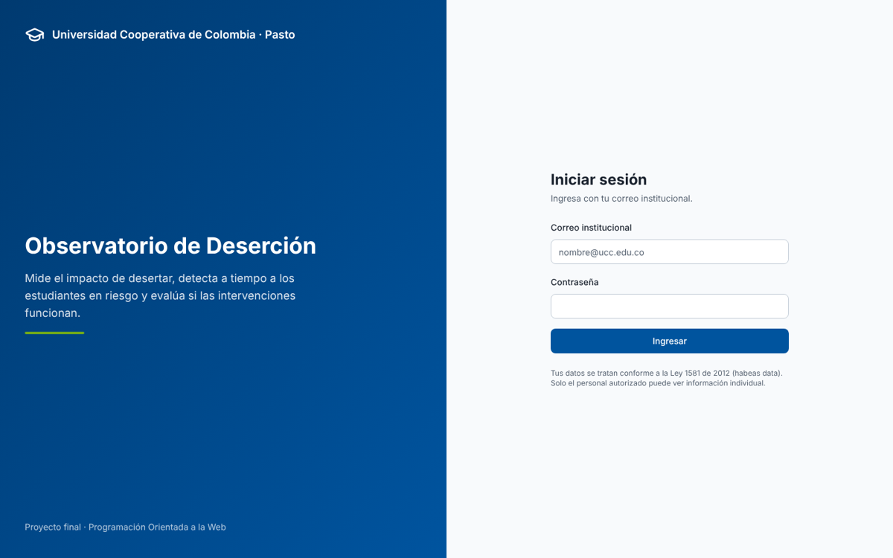 | 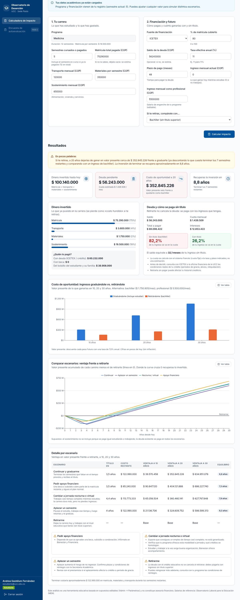 |

| Parámetros (Admin) | Móvil |
|---|---|
| 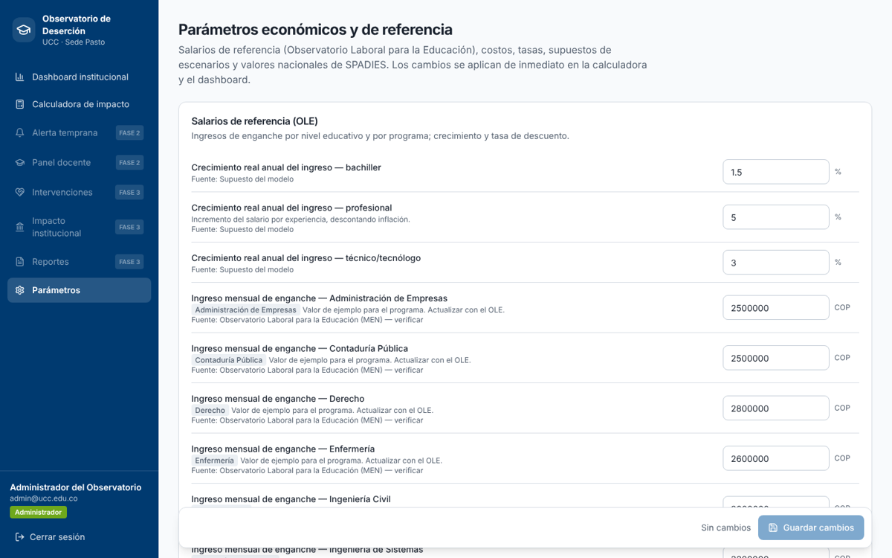 | 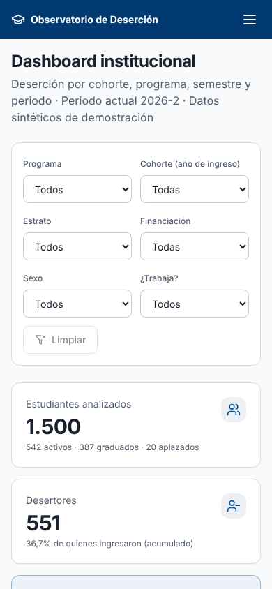 |

| Alerta temprana (Bienestar) | Ficha del estudiante |
|---|---|
| 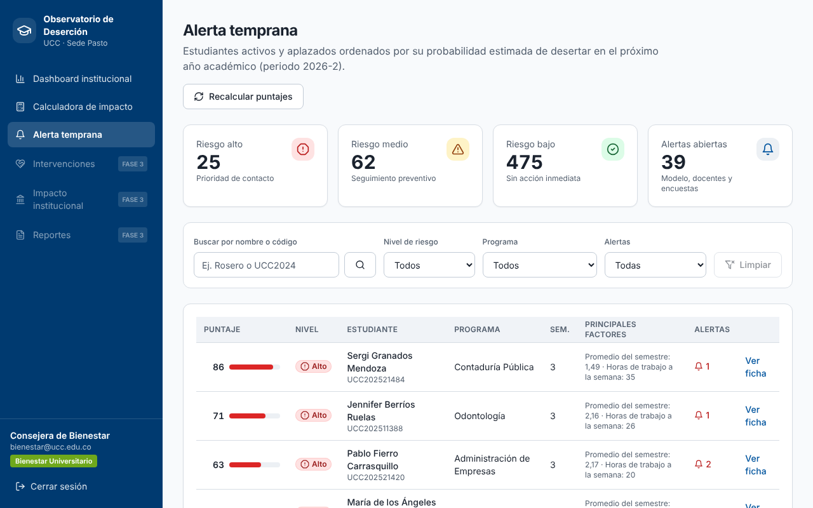 | 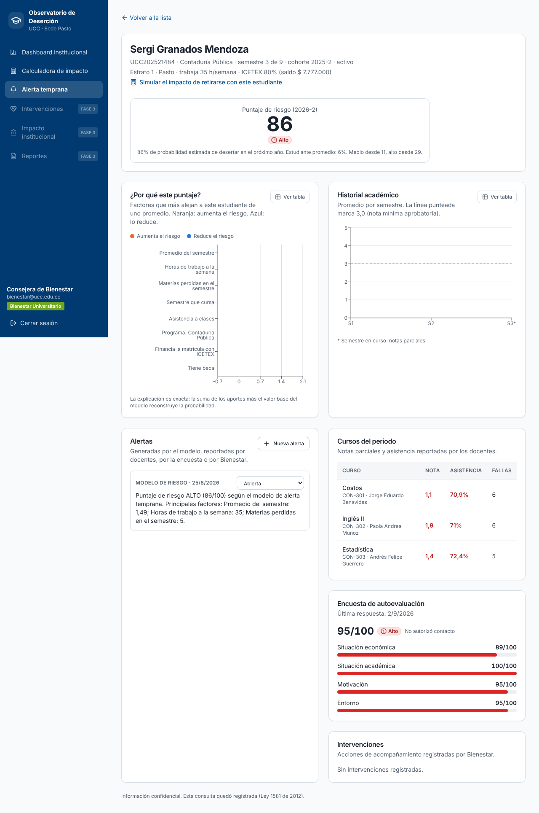 |

| Panel docente | Encuesta de autoevaluación |
|---|---|
| 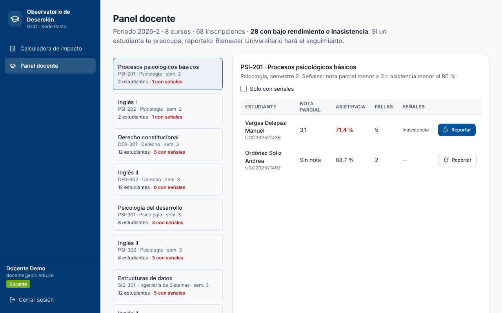 | 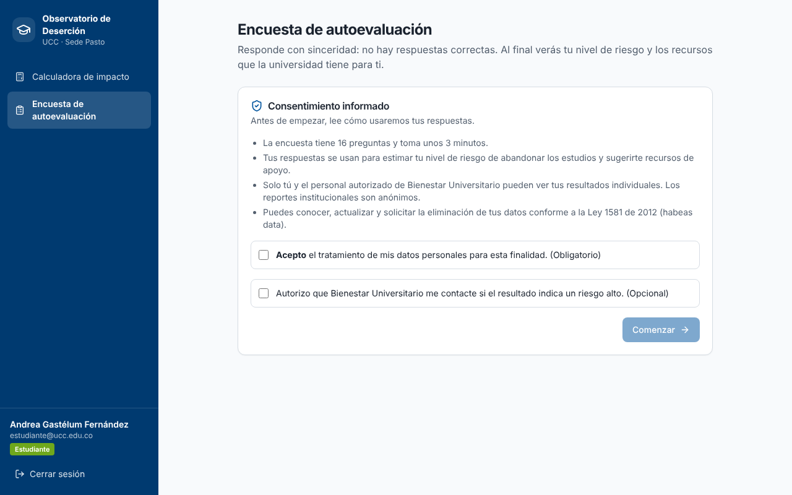 |

| Intervenciones y efectividad | Impacto institucional y regional |
|---|---|
| 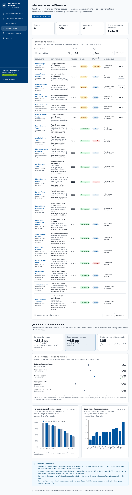 | 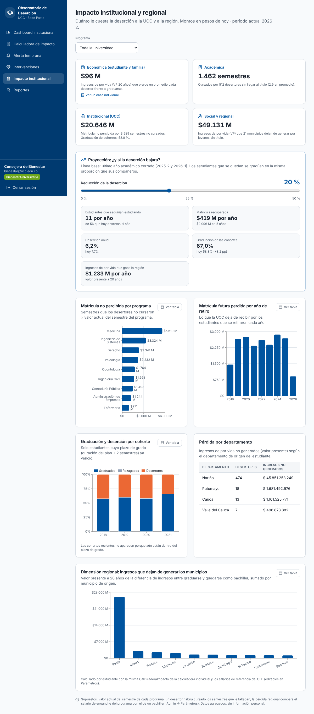 |

| Reportes PDF / Excel | Panel de administración |
|---|---|
| 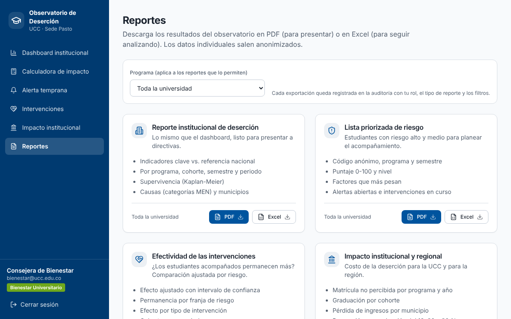 | 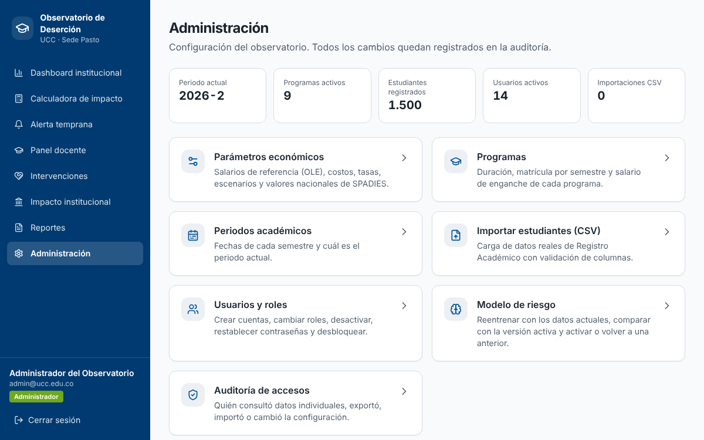 |

| Modelo de riesgo: reentrenamiento | Usuarios y roles |
|---|---|
| 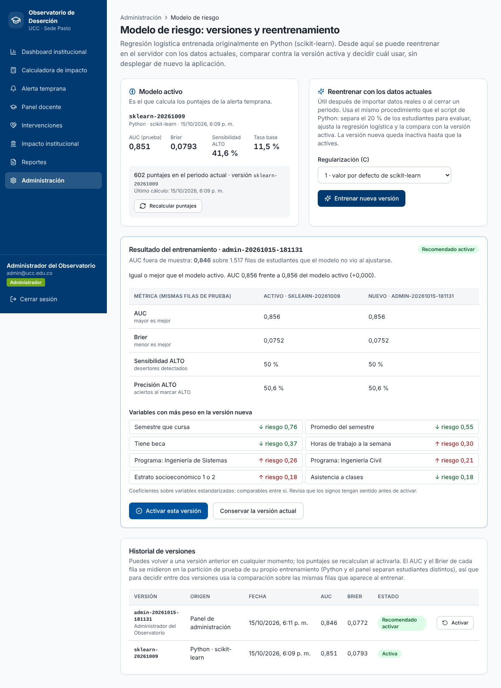 | 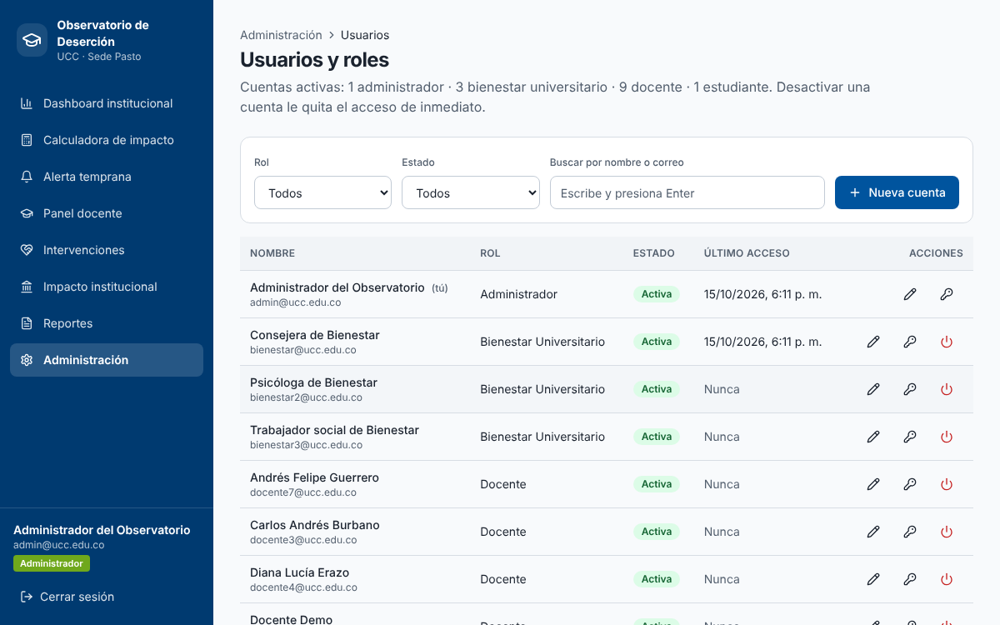 |

| Importación CSV | Auditoría de accesos |
|---|---|
| 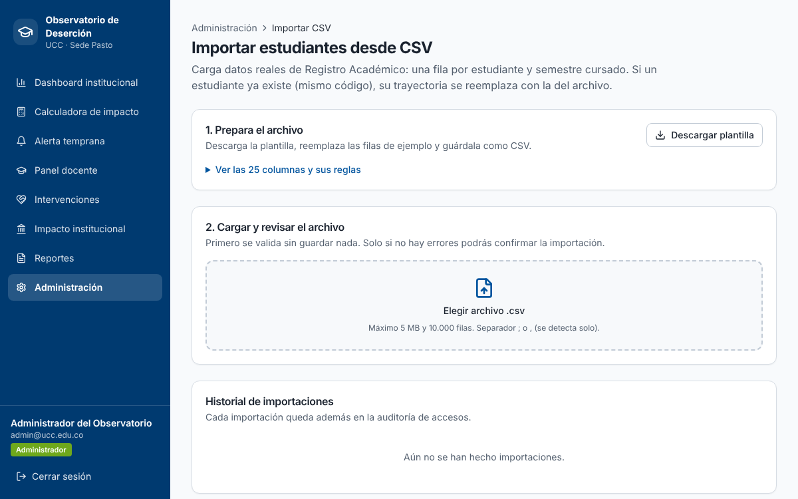 | 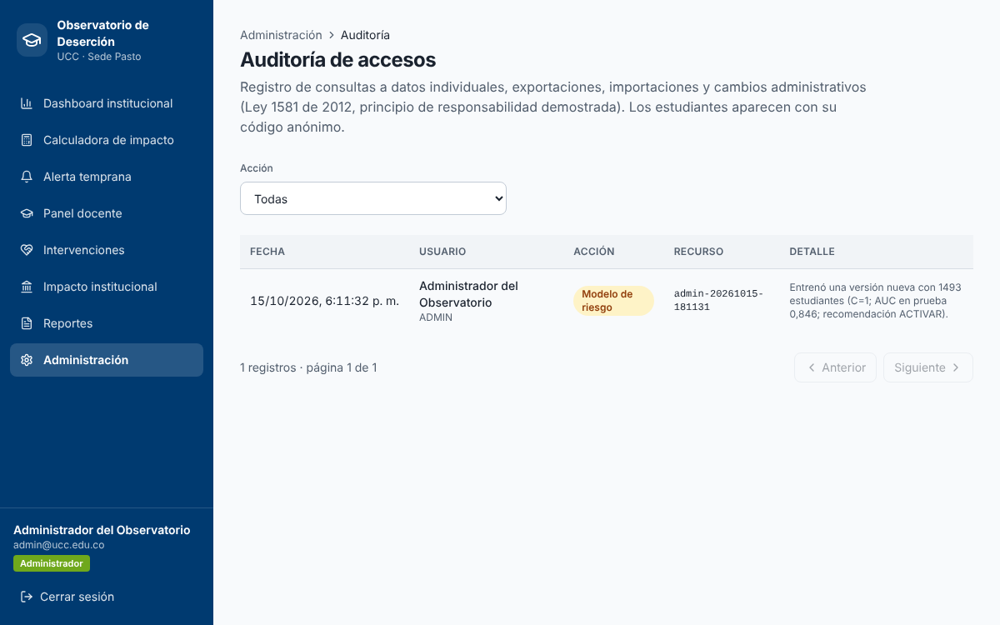 |

## 14. Colores institucionales

Definidos en `tailwind.config.ts` (`ucc.azul`, `ucc.azul-oscuro`, `ucc.verde`...) y `app/globals.css`. Ajústalos con el manual de identidad visual oficial de la UCC si los tonos difieren.

## 15. Fuentes de referencia

- Ministerio de Educación Nacional — SPADIES (deserción anual 2023: 8,97 % total y 7,82 % universitaria; deserción por cohorte 2016-1: 9,7 % en el semestre 1, 25,5 % en el 5 y 36,7 % en el 10).
- Observatorio Laboral para la Educación (MEN) — salarios de enganche de recién graduados.
- Decretos 1469 y 1470 de 2025 — SMMLV 2026 ($1.750.905) y auxilio de transporte.
- Ley 1581 de 2012 — Protección de datos personales.

Las participaciones nacionales por categoría de causa vienen como **valores ilustrativos** y deben reemplazarse con la distribución oficial antes de usarse como referencia.

## 16. Historial de desarrollo (Git)

El proyecto se desarrolló con **una rama por funcionalidad**, integrada a `main` con merge explícito (`--no-ff`), así que cada módulo se puede rastrear de principio a fin. Los mensajes siguen *Conventional Commits* en español:

| Prefijo | Uso |
|---|---|
| `feat(ámbito)` | Funcionalidad nueva (`feat(admin)`, `feat(riesgo)`, `feat(api)`…) |
| `fix(ámbito)` | Corrección de un error encontrado en pruebas o auditoría |
| `test(ámbito)` | Pruebas automatizadas (normalmente antes o junto a la funcionalidad) |
| `refactor`, `docs`, `build`, `chore` | Reorganización sin cambio de comportamiento, documentación, dependencias y versiones |

Cada fase cerró con una **etiqueta**: `v0.1.0-fase1`, `v0.2.0-fase2` y `v0.3.0-fase3`.

```bash
git log --oneline --graph --decorate        # historial completo con las ramas integradas
git log --oneline v0.2.0-fase2..v0.3.0-fase3 # lo que se hizo en la Fase 3
git log --merges --oneline main             # una línea por funcionalidad integrada
git show --stat v0.3.0-fase3                # contenido de la entrega final
```
