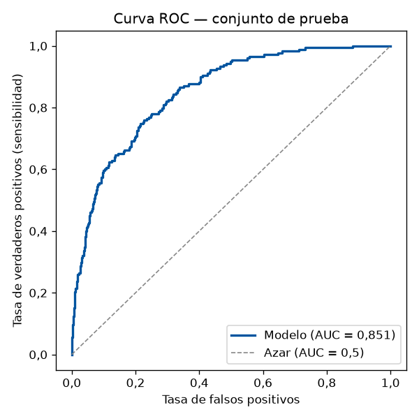
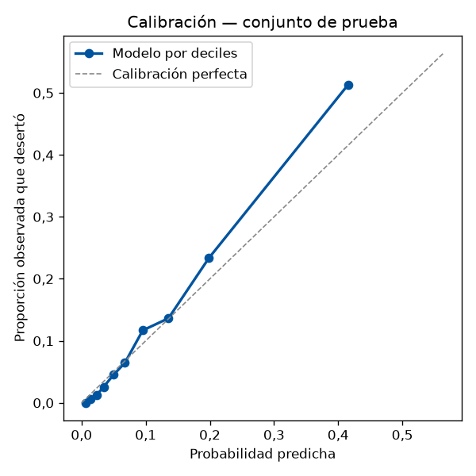

# Reporte del modelo de riesgo de deserción

Generado por `ml/entrenar_modelo.py` el 2026-10-09 10:06 (hora de Colombia). Versión **sklearn-20261009**.

## Datos

- 8.042 filas estudiante-semestre de 1.493 estudiantes; 21 características.
- Objetivo: desertar al terminar el semestre o el siguiente (horizonte 2 semestres). Tasa base: **10,7 %**.
- Separación entrenamiento/prueba **por estudiante** (80/20) para evitar fuga de información entre semestres de una misma persona.

## Desempeño en el conjunto de prueba

| Métrica | Valor |
|---|---|
| AUC-ROC | **0,851** |
| AUC validación cruzada (5 pliegues por estudiante) | 0,815 ± 0,011 |
| AUC de la regla simple "promedio bajo" | 0,770 |
| Brier | 0,0793 |
| Log-loss | 0,2661 |
| Umbral de riesgo ALTO | 26 % de probabilidad |
| Precisión en ALTO | 51,7 % |
| Sensibilidad en ALTO | 41,6 % |

Matriz de confusión (ALTO vs. resto): VP 74, FP 69, FN 104, VN 1299.

 

## Coeficientes (variables estandarizadas)

Un coeficiente positivo aumenta el riesgo. La razón de probabilidades (odds ratio) indica cuánto se multiplican las
probabilidades de desertar por cada desviación estándar que aumenta la variable.

| Característica | Coeficiente | Odds ratio |
|---|---|---|
| `semestre` | −0,757 | 0,47 |
| `promedio` | −0,552 | 0,58 |
| `fin_beca` | −0,366 | 0,69 |
| `horas_trabajo` | +0,304 | 1,35 |
| `programa:Ingeniería de Sistemas` | +0,262 | 1,30 |
| `programa:Ingeniería Civil` | +0,213 | 1,24 |
| `estrato_1_2` | +0,182 | 1,20 |
| `asistencia` | −0,181 | 0,83 |
| `materias_perdidas` | +0,176 | 1,19 |
| `programa:Contaduría Pública` | +0,171 | 1,19 |
| `ingreso_22_mas` | +0,162 | 1,18 |
| `fin_credito_ucc` | −0,160 | 0,85 |
| `primer_anio` | −0,152 | 0,86 |
| `fin_icetex` | −0,126 | 0,88 |
| `estrato_4_mas` | −0,094 | 0,91 |
| `programa:Psicología` | +0,080 | 1,08 |
| `programa:Medicina` | +0,062 | 1,06 |
| `caida_promedio` | +0,051 | 1,05 |
| `programa:Odontología` | −0,038 | 0,96 |
| `programa:Enfermería` | −0,028 | 0,97 |
| `programa:Administración de Empresas` | +0,020 | 1,02 |

Intercepto: -2,782 (probabilidad de un estudiante promedio: 5,8 %).

## Niveles

- **BAJO**: probabilidad < 11 % (por debajo de la tasa base).
- **MEDIO**: entre 11 % y 27 %.
- **ALTO**: ≥ 27 % (2,5 veces la tasa base).

> Los datos son sintéticos: las relaciones que el modelo encuentra son las que se programaron en el generador.
> Con datos reales de la UCC el procedimiento es el mismo (exportar, entrenar, revisar este reporte).
